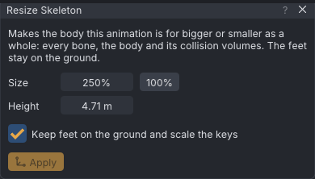

# Resize skeleton

**View → Body → Resize Skeleton...** makes the body an animation is made for bigger or smaller as a whole: every
bone, the body mesh and the collision volumes, with the feet kept on the ground. Use it to animate for a giant, a
tiny avatar or a big creature, or to fit an animation you already made to one. It can scale the keys too, so a crouch
or a sit keeps its depth on the new body.

> Related articles: [[Skeleton]], [[Mesh bodies]], [[Export to Second Life]], [[Deformers]], [[Rig any model]]

## Usage

### Resizing the skeleton

1. **View → Body → Resize Skeleton...**
2. Set **Size**: drag it, or double-click it and type a percentage. `200%` is twice as big, `50%` half. Or type the
   **Height** you want in metres and the size follows.
3. Leave **Keep feet on the ground and scale the keys** ticked to scale the animation with the body (see below).
4. Press **Apply**. The view frames the body as before, at its new size.

*SL Default at 250%: 4.71 m tall, as SL's shape editor reads it.*

**Apply** is one undo step, **Resize Skeleton**. The size is saved with the project, beside the **Bake shape** in
Properties → Export, which shows **Resized to N%** while it is not 100%; click it to open the window. Each clip of a
project, and each actor, has its own size. **100%** puts the body back.

The **Scale** tool does not resize the skeleton: it scales static props only.

### Keep feet on the ground and scale the keys

Ticked (the default), **Apply** also multiplies by the change of size:

- the hip's position keys (`mPelvis`), so a crouch, a sit, a jump or a sway keeps its depth on the bigger or smaller
  body, and feet that touched the ground still touch it;
- the IK targets and poles of the legs, arms and spine;
- positions held by [[Hold and bind|Hold in World]], and by **Bind to** another bone of the same actor, with any keyed
  slide of the held point.

Rotations are left as they are: they already fit any size. Bones other than the hip need nothing either, since a
bone's position keys grow with the bone it hangs from. Binds to another actor's bones, props and where the actors
stand are left as they are.

Unticked, only the body changes size. The hip's moves keep their metres, so a crouch is shallower on a bigger body
(its feet leave the ground) and goes through the floor on a smaller one. Use it when the keys already fit the new
size.

Resizing back (from 250% to 100%) with the box ticked undoes the scaling of the keys.

### What the size changes

The resized body is what VATs poses, solves and bakes on: the view, IK and pins, Auto IK, the [[Animation check]],
[[Dynamics]], the [[Ragdoll]], **Push Hands Out of the Body** and the **Bake shape** of every export. Other actors
keep their own sizes. [[Retargeting]] makes a new animation at 100%: resize it afterwards.

In Second Life, big and small avatars are made with joint positions (a mesh uploaded with **Include joint
positions**), not by scaling. So **Export .anim** and BVH write the positions as such an avatar holds them:

- the hip's position keys as they are (with the box ticked, already scaled);
- every other position key at its resized place: the size times the bone's position and move;
- a BVH's skeleton (`OFFSET`s) at the new size.

An exported animation fits an avatar of that size, rigged with joint positions: one made in Blender with Avastar or
Bento Buddy by scaling the rig and the mesh together, for example. On an avatar of another size, bones with position
keys stand where they would on yours.

**Also export for heights** (see [[Export to Second Life]]) is off while any actor is resized: those heights are SL
shapes at 100%, and the keys fit the resized body.

## Tips and tricks

- Resize first, then animate: IK, pins and the ground then work at the right size from the first key.
- To fit a finished animation to a giant, resize with the box ticked, then run the [[Animation check]] and play it
  through. Its ground tolerance grows with the size: a 2 cm step at 100% is 5 cm at 250%.
- A [[Deformers|deformer]] keeps its counters right at any size: **Hold without sinking** works on the resized body.
- An imported `.anim` that is resized is written again, not passed through unchanged as an untouched import is.

## Troubleshooting

### The feet float or sink after resizing

**Keep feet on the ground and scale the keys** was off, so the hip's moves kept their metres. Undo (**Ctrl+Z**) and
apply again with the box ticked.

### In the viewer, who sees my avatar resized

Only you. The editor draws your avatar at the new size on your screen: nothing goes to the region, and everyone else
sees you as you are. It goes back to its own size when you close the editor, go back to 100%, or choose **As It Plays
In-World**, which shows the animation on your avatar as the world will play it.

## See also

- [[Rig any model#A creature is huge or tiny]] and [[Rig a model from scratch#Configuration]]: the **Size** of a model
  you rig, which sets the size of the rig itself.
- [[Deformers]]: animations that move bones, and why they sink the wearer.

Category: Animating
